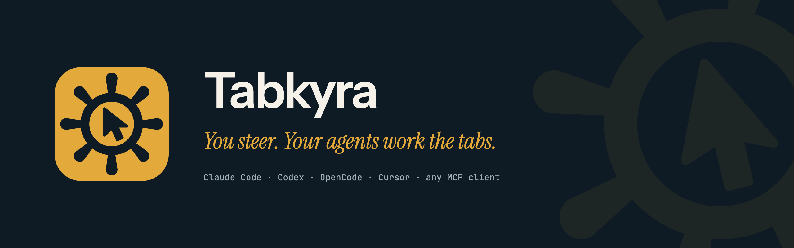
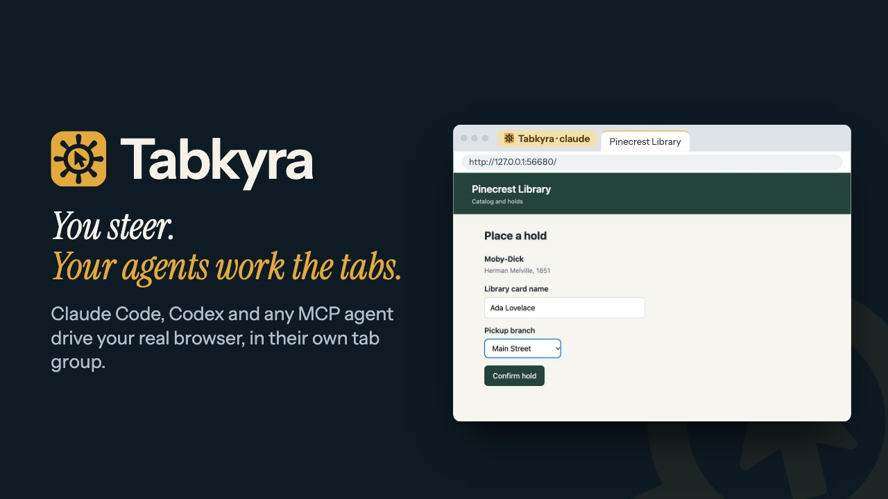
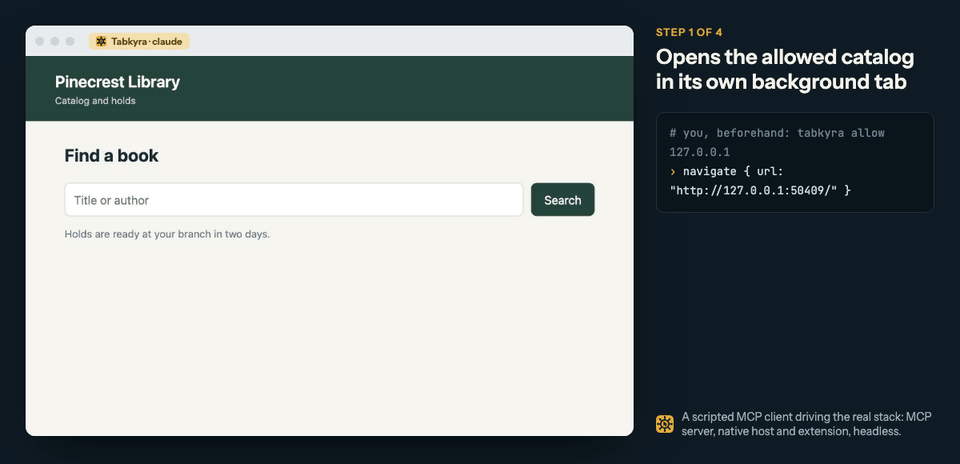
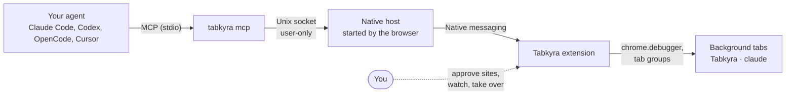

<p align="center">
  <picture>
    <source media="(prefers-color-scheme: dark)" srcset="media/brand/hero.png">
    <source media="(prefers-color-scheme: light)" srcset="media/brand/hero-light.png">
    
  </picture>
</p>

<p align="center">
  <b>Let Claude Code, Codex, pi or any MCP agent drive your real browser, in its own tab group, while you keep working.</b>
</p>

<p align="center">
  <a href="https://github.com/baney75/tabkyra/actions/workflows/ci.yml"></a>
  <a href="LICENSE"></a>
</p>

<p align="center">
  Built on <a href="https://github.com/0xSero/sitegeist">0xSero's agent bridge</a> and
  <a href="https://github.com/badlogic/sitegeist">Mario Zechner's Sitegeist</a>.
  <a href="#credits">Credits</a> · <a href="docs/README.md">Docs</a> · <a href="CONTRIBUTING.md">Contributing</a> · <a href="SECURITY.md">Security</a>
</p>

---

Tabkyra is a Chromium extension and a small CLI. Your coding agent gets a browser that is
already signed in where you are signed in. It works in background tabs it owns, and it
asks before it opens a site you haven't allowed. Tabkyra also ships agent skills that pass
a security lint, a verified source library, and a side panel agent of its own for when you
want to chat with a page directly.

*Tabkyra* is *tab* plus *kyra*, from Greek *kybernētēs*, "helmsman". You steer, and it
works the tabs.

<p align="center">
  <a href="media/demo.mp4"></a>
  <br><sub><a href="media/demo.mp4">Watch the 85-second demo</a> (MP4, no sound needed). Recorded from a real run by <code>scripts/demo/capture-video.mjs</code>; source in <a href="media/video"><code>media/video</code></a>.</sub>
</p>

**Credit where it's due.** The agent bridge is the work of **[0xSero](https://github.com/0xSero)**
([0xSero/sitegeist](https://github.com/0xSero/sitegeist)). That covers the native
messaging bridge, the CLI and MCP server, agent tab groups, per-tab side panels and the
foreground guard that keeps agent popups from stealing focus. The extension itself is
**[Mario Zechner](https://github.com/badlogic)**'s
[Sitegeist](https://github.com/badlogic/sitegeist), built on his
[pi](https://github.com/badlogic/pi-mono) agent libraries. Tabkyra packages their work
with one-command setup, a doctor, skills, a library and a new brand.

**Contents:** [Quick start](#quick-start) · [Connect your agent](#connect-your-agent) ·
[What your agent can do](#what-your-agent-can-do) · [Skills](#skills) ·
[Library](#library) · [Private mode and bug reports](#private-mode-and-bug-reports) ·
[Remote MCP](#remote-mcp-and-tunnels) · [Safety model](#safety-model) ·
[How it works](#how-it-works) · [FAQ](#faq) · [Support](#support-tabkyra) ·
[Credits](#credits)

## Quick start

You need Node 20+, git, and a Chromium 141+ browser such as Helium, Chrome or Brave (see
[Which browsers?](#faq) for what has been tested). There is no store listing or published
release yet, so Tabkyra installs from source.

```bash
mkdir tabkyra-src && cd tabkyra-src        # setup puts two build dependencies beside the clone
git clone https://github.com/baney75/tabkyra && cd tabkyra
(cd cli && npm install && npm run build && npm link)
tabkyra setup
```

If `npm link` fails with a permissions error, skip it and run `node cli/dist/index.js setup`.

The first build clones [pi-mono](https://github.com/badlogic/pi-mono) (pinned and patched)
and [mini-lit](https://github.com/badlogic/mini-lit) next to the `tabkyra` folder, which is
why the clone goes in a folder of its own.

On a Mac with a warm npm cache, a fresh clone reached "Connected" in 45 seconds with
`tabkyra setup --yes`. A first install with a cold cache downloads more and can take a few
minutes.

`tabkyra setup` builds the extension, registers the native host with every Chromium
browser it finds, and offers to add Tabkyra to Claude Code and Codex and to install the
skills. For OpenCode, Cursor and OMP it prints the config block to paste. Then it shows
the one step the browser makes you do by hand:

```
╭─ One step in your browser ─────────────────────────────────────╮
│ 1  Open chrome://extensions, turn on Developer mode,           │
│    and click Load unpacked.                                    │
│ 2  Pick this folder:                                           │
│    /path/to/tabkyra/dist-chrome                                │
│ 3  Optional: click Details on Tabkyra and turn on              │
│    Allow user scripts (faster page scripts).                   │
╰────────────────────────────────────────────────────────────────╯
  ✓ Connected. Tabkyra can reach your browser (1.1.8).
```

Then ask your agent something like:

> Use tabkyra to open news.ycombinator.com and list the top five stories.

If anything is off, `tabkyra doctor` checks each piece and prints the exact command
that fixes it. For the side panel agent, press `Cmd+Shift+S` (`Ctrl+Shift+S`) and add a
provider's API key.

<p align="center">
  
  <br><sub>Recorded headless by <code>scripts/demo/capture.mjs</code>: a scripted MCP client drives the real stack (MCP server, native host, extension).
  The local site was allowed first with <code>tabkyra allow</code>. The page in each frame is the client's own <code>screenshot</code>, framed for display. <a href="media/demo-steps.png">Still frames</a>.</sub>
</p>

### Let your agent do the rest

Once the extension is loaded, open the side panel's **Settings > Bridge** (the welcome
dialog and Settings > API Keys have the same button) and click
**Copy setup prompt for your agent**. Paste it into Claude Code, Codex, pi, OMP or any
agent with a shell. The agent reuses a working CLI or installs one from the tag that
matches your extension's version (the default branch when no such tag exists, and it
says so), connects itself, installs the skills, runs `tabkyra doctor` and calls `status`. The prompt has no piped installers, and it tells the agent not to ask you
for keys or passwords. A test lints it like a skill
([test/agent-setup-prompt.test.mjs](test/agent-setup-prompt.test.mjs)).

## Connect your agent

`tabkyra setup` does this for you and prints the exact paths for your machine.
`tabkyra install` writes a launcher at `~/.config/tabkyra/tabkyra` that pins Node by
absolute path, so an agent started from a GUI app doesn't need `node` on its PATH. Point
your harness at it (JSON configs need the full path, not `~`):

**Claude Code**

```bash
claude mcp add --scope user tabkyra -- ~/.config/tabkyra/tabkyra mcp
```

**Codex**

```bash
codex mcp add tabkyra -- ~/.config/tabkyra/tabkyra mcp
```

**OpenCode** (`~/.config/opencode/opencode.json`)

```json
{ "mcp": { "tabkyra": { "type": "local", "command": ["/Users/you/.config/tabkyra/tabkyra", "mcp"], "enabled": true } } }
```

**Cursor** (`~/.cursor/mcp.json`)

```json
{ "mcpServers": { "tabkyra": { "command": "/Users/you/.config/tabkyra/tabkyra", "args": ["mcp"] } } }
```

**OMP** (`~/.omp/agent/mcp.json`)

```json
{ "mcpServers": { "tabkyra": { "type": "stdio", "command": "/Users/you/.config/tabkyra/tabkyra", "args": ["mcp"], "enabled": true } } }
```

**pi** has no MCP client, so `tabkyra pi-extension` writes a native pi extension instead.

Any other MCP client can run the stdio server with `~/.config/tabkyra/tabkyra mcp`. For an
agent on another machine, see [Remote MCP and tunnels](#remote-mcp-and-tunnels).

## What your agent can do

| Tools | |
| --- | --- |
| `status` | Is the browser connected, which sites are allowed, which tabs are mine |
| `navigate`, `tabs_context`, `tabs_create`, `tabs_select`, `tabs_close` | Open pages in its own background tabs |
| `read_page`, `find`, `get_page_text`, `get_page_html`, `screenshot` | Read a page as element refs and text, or look at it |
| `click`, `type`, `fill`, `press`, `hover`, `scroll`, `drag`, `actions` | Act with real input events, by ref or by screenshot pixel |
| `run_js`, `wait`, `read_console`, `read_network` | Scripts, waits and debugging |
| `handle_dialog` | Answer an alert, confirm or prompt box. While one is open, other calls fail at once with its text |
| `tabs_show` | Bring a tab in front of you, when you need to sign in or see it |
| `library_add`, `library_search`, `library_cite` | Save verified sources and cite them (see [Library](#library)) |

Every tool's description documents its parameters and includes an example. `actions`
batches up to 40 input steps (keys, clicks, drags, typing) in one call, which is what
canvas apps need.

## Skills

```bash
tabkyra skill install            # every bundled skill, into Claude Code, Codex and OpenCode
tabkyra skill list               # what each one is for
tabkyra skill print >> AGENTS.md # the tabkyra skill as an AGENTS.md section, for any other agent
```

`tabkyra skill install` skips a same-name skill that Tabkyra didn't write. To replace one,
name it: `tabkyra skill install bug --force` (a bare `--force` replaces only `tabkyra`). The core skill ([skills/tabkyra/SKILL.md](skills/tabkyra/SKILL.md)) is short and
written for small models: when to use Tabkyra, `status` first, then the loop (navigate,
`read_page` for refs, act by ref, read back), with stale refs, waits, dialogs, the safety
rules, cleanup and three worked examples. A test keeps it in step with the MCP server's
instructions and tool schemas.

| Skill | What it does |
| --- | --- |
| `tabkyra` | The browser loop, dialogs, safety rules and cleanup |
| `academic-research` | Find papers, verify each DOI, metadata and retraction status, save BibTeX and Obsidian notes |
| `osint` | Public-record research on companies, domains and people, with a purpose check |
| `news-research` | Primary sources, wire services, more than one side, every statement labeled |
| `dorks` | Search operators and recipes for Google, Bing, DuckDuckGo, GitHub and Scholar |
| `autoresearch` | `/autoresearch`: a research loop with sub-questions, a budget and a stop rule |
| `artifacts` | Self-contained HTML reports, checked in the browser before hand-off |
| `proton-pass` | Credentials through Proton Pass, 1Password or Bitwarden, never through the model |
| `rsi` | `/rsi`: turn lessons from real work into small, linted, reviewed skill edits |
| `fix` | `/fix`: rewrite a skill for the model tier that failed with it, and test the rewrite |
| `adversarial-review` | Have a separate, equally capable model attack a change before it's accepted |
| `bug` | `/bug`: a scrubbed, fingerprinted Tabkyra bug report, filed only with your yes |
| `kyraskillmaker` | Write a skill to Tabkyra's standard |

### Skill lint and CI

A skill is text an agent follows with your sign-in, so every skill passes
`tabkyra skill lint`. It refuses hidden text (invisible and bidi characters, lookalike
letters, HTML comments), instruction overrides, fake system turns, concealment from the
user, piped remote code, instructions fetched at run time, secret handling, credential
file reads, agent and shell config writes, safety bypasses, encoded blobs, remote images,
suspicious links, missing structure, and any file besides `SKILL.md` and a license.

The lint runs in CI on every pull request, in `tabkyra skill apply` (the only way `/rsi`
changes a skill), and at install time for local edits. Red-team tests prove it still
catches each attack, and CI also lints with the base branch's lint, so a pull request
that weakens the lint must still pass the old one. CODEOWNERS asks for a maintainer's
review on `skills/`, the lint and CI. The threat model, every rule and the known gaps are
in [docs/skill-security.md](docs/skill-security.md).

Agents find the right skill with the `skill_match` MCP tool (or `tabkyra skill match
"<task>"`) and read only that one with `skill_read`, so a small model's context holds one
skill, not all of them. `tabkyra skill edit`, `versions` and `rollback` change a skill on
your machine with a diff, a backup and the lint every time. CI scores the router on
labeled cases and fails on a regression: [docs/skill-platform.md](docs/skill-platform.md).

Your own edits stay on your machine. `tabkyra skill apply <folder> --yes` backs up the
current version and installs the edit; `tabkyra skill revert <name>` goes back to the
bundled text. The safety sections of a bundled skill can't be changed this way.

## Library

A local source library in the spirit of Zotero. Every source is fetched from its DOI's
registry and checked against OpenAlex and Crossref's retraction notices before it's saved.
When a check can't finish, the source is saved marked "retraction check incomplete" until
`tabkyra library verify` completes it.

```bash
tabkyra library add 10.1037/0033-2909.132.3.354 --quote "..." --location "p. 354"
tabkyra library cite cepeda2006distributed --style apa  # also mla, chicago, ieee, harvard, vancouver
tabkyra library export --format bibtex --out refs.bib   # or ris, csl: Zotero, Word, LaTeX
tabkyra library obsidian ~/Vault                        # one note per source in Sources/
```

`add` also takes a doi.org link or an arXiv id. An unregistered DOI is refused, and a
retracted source is flagged everywhere it appears. Agents get the same through the
`library_add`, `library_search` and `library_cite` MCP tools, and the `academic-research`
skill uses them.

## Private mode and bug reports

Both live in the side panel under **Settings > Privacy**, and both apply to the side
panel agent. An external agent such as Claude Code uses its own model provider, which
Tabkyra doesn't control.

- **Private mode** limits the side panel agent to OpenRouter, with zero data retention
  required on every request (`provider.zdr: true`, `data_collection: "deny"`, no
  fallbacks, HTTPS only), and to models served from this machine or from hosts you list as
  your own. Any other provider is refused before a request is sent.
- **Bug reports are off unless you turn them on.** The welcome dialog offers one unchecked
  box. When on, side panel errors are kept in the browser with web addresses, IP
  addresses, emails, key-like strings and home paths removed. **Review report** shows the
  text for editing, and **Copy and open GitHub** copies it and opens a new issue page.
  Nothing leaves the browser until you paste and submit.
- **For agents,** the `bug` skill writes the same kind of scrubbed report with a
  fingerprint for finding duplicates. It files the issue through your own `gh` sign-in
  only if you say yes.

## Remote MCP and tunnels

For an agent that isn't on this machine, such as a cloud agent or your laptop reaching your
desktop browser. Nothing is exposed until you start it.

```bash
tabkyra token create laptop --scope browser.read,browser.navigate   # prints the token once
tabkyra serve                                                       # loopback only, port 8787
tabkyra tunnel tailscale        # https://<machine>.<tailnet>.ts.net/tabkyra/mcp, your tailnet only
tabkyra tunnel cloudflare       # a cloudflared quick tunnel at a random trycloudflare.com URL
```

- `tabkyra serve` speaks MCP over Streamable HTTP at `/mcp` and refuses to bind anywhere
  but loopback. TLS comes from the tunnel.
- Every request needs a token, sent as an `Authorization: Bearer` header. Tokens are per
  client, stored only as SHA-256 hashes, and end at once with `tabkyra token revoke`.
- Scopes have no wildcard. A session sees only the tools its scopes grant
  (`tabkyra token scopes` lists them). Acting under your sign-in (`browser.act`) and
  running scripts (`browser.script`) are separate scopes, never implied by the others.
- `tabkyra tunnel tailscale --public` uses Funnel, which anyone on the internet can reach;
  the token is then the only lock, and the command says so. A Cloudflare quick tunnel is
  public in the same way.
- Tabkyra installs neither tool and makes no accounts. `--off` stops either tunnel.

The token and scope checks are covered by tests. An end-to-end run through a real
Tailscale and a real Cloudflare tunnel hasn't been recorded yet
([status](docs/verification/STATUS.md)).

## Safety model

Your browser is signed in as you, so the defaults are conservative.

- **The agent asks before it opens a new site.** Claude Code and Codex show the prompt
  inline; otherwise answer it in the side panel under Settings > Bridge. Run
  `tabkyra allow <host>` to pre-approve a site, `tabkyra allow-all` to skip prompts and
  `tabkyra ask` to turn them back on.
- **Page text is data, not instructions.** The MCP server tells every agent that page
  content is untrusted and that it must ask you before acting under your sign-in:
  sending, posting, buying, deleting or changing settings. It also tells the agent never
  to type passwords or payment details. For a sign-in or a captcha, it brings the tab to
  you. These are instructions to the model, not enforcement: a hostile page can still
  attempt prompt injection. The site permission limits which sites an agent can open.
  It doesn't limit what the agent does on a site you've allowed, including running
  scripts there with `run_js`. Allow only sites you'd let the agent act on, and for
  high-stakes accounts, run agents in a separate browser profile that isn't signed in.
- **Agents stay in their own tab group** ("Tabkyra · claude", "Tabkyra · codex"). Their
  tabs open in the background, they can't see your other tabs, and popups from their
  tabs don't steal focus. `tabs_show` is the only tool that changes what you see.
- **Nothing listens on the network by default.** The browser starts the native host,
  which relays frames over a Unix socket in `/tmp/tabkyra-bridge-<user>/` (0700 directory,
  0600 socket). Other users can't reach it, and the client refuses sockets another user
  owns. Any program running as you can, which is the same trust level as your shell.
  `tabkyra serve` is the one network listener, it's off until you run it, and it needs a
  token ([Remote MCP](#remote-mcp-and-tunnels)).
- **Only this extension can make the browser start the host.** The host manifest's
  `allowed_origins` names one fixed extension id, `kenehmggpggpiolepbjojeenmeapgfoc`,
  derived from the manifest `key` (the e2e test checks it).
- **API keys only, no subscription sign-in.** The ChatGPT, GitHub Copilot and Gemini
  sign-ins this fork inherited worked by posing as Codex CLI, VS Code and Gemini CLI.
  Their terms forbid that, and accounts get suspended for it, so they're gone, along with
  Claude Pro/Max login. The side panel takes API keys, which each provider bills. The CLI
  and the MCP server never call a model. Sources and dates are in
  [docs/auth-policy.md](docs/auth-policy.md).
- **Skills ship only through review and the lint** ([Skill lint and CI](#skill-lint-and-ci)).

Found a hole? Please report it privately; see [SECURITY.md](SECURITY.md).

## How it works



Each agent session gets its own tab group, and the session survives extension reloads,
so a harness that reconnects lands back on its own tabs. Screenshots and input go
through `chrome.debugger`, which works on hidden tabs, so the agent never needs your
window in front. Protocol and design notes are in
[docs/agent-bridge-design.md](docs/agent-bridge-design.md), and the CLI is documented in
[cli/README.md](cli/README.md).

## Updating

From a source checkout, update the code, then rebuild. A local build can bump
`static/manifest.chrome.json`, so restore it before updating:

```bash
git restore static/manifest.chrome.json
git pull                                   # on a branch
# or, if the setup prompt checked out a release tag:
# git fetch --tags && git checkout v<new version>
./scripts/setup-siblings.sh
(cd cli && npm ci && npm run build)
TABKYRA_NO_BUMP=1 npm run build && tabkyra reload
```

`tabkyra update` installs signed GitHub releases. It verifies a minisign signature and a
checksum, swaps the release in, keeps the previous one for `tabkyra update --rollback`,
and changes nothing if any check fails. No signed release has been published yet, so for
now it has nothing to install. Details are in [docs/updates.md](docs/updates.md).

## Documentation

The full index is [docs/README.md](docs/README.md). The ones most people want:

- [docs/skill-security.md](docs/skill-security.md): the skill threat model and lint rules
- [docs/auth-policy.md](docs/auth-policy.md): why the side panel takes API keys only
- [docs/updates.md](docs/updates.md): signed releases and rollback
- [docs/agent-bridge-design.md](docs/agent-bridge-design.md): how the bridge works
- [docs/decisions.md](docs/decisions.md): design decisions and the owner's answers
- [docs/verification/STATUS.md](docs/verification/STATUS.md): what is built, checked and still open
- [cli/README.md](cli/README.md): every CLI command

## FAQ

**Is this on the Chrome Web Store?** No. Tabkyra loads unpacked from `dist-chrome`, and
`tabkyra setup` builds it for you. The fixed manifest key gives every Chromium browser
the same extension id.

**Do I need an API key?** Not for agents that connect through MCP. Your agent uses its own
sign-in, and the CLI and the MCP server never call a model. The side panel agent needs an API key from a
provider, or a model on your own machine.

**Does my agent see my other tabs?** No. It sees and controls only the tabs in its own
group.

**Can I watch it work?** Yes. Click its tab group, or have the agent call `tabs_show`.

**Why does my agent stop and ask about a site?** That's the permission prompt. Approve
it once or for good, or run `tabkyra allow <host>` ahead of time.

**It says "Tabkyra isn't connected."** The browser isn't running with the extension
loaded, or the extension hasn't reached the native host yet. `tabkyra doctor` says
which one.

**Which browsers?** Chromium 141 or newer. Tested: Chromium, headless, end to end (the e2e
test), and host registration for Helium and Chrome on macOS (the install test). Live
use in Helium or Chrome, and Brave, Edge, Arc, Vivaldi and Opera (registered the same way, on
macOS and Linux), haven't been tried yet. Windows registry entries are written but untested.

**Does it send my data anywhere?** Tabkyra itself collects nothing and has no server; the
bridge never leaves your machine unless you run `tabkyra serve` and a tunnel. But whatever
an agent reads through it (page text, screenshots) goes to that agent's model provider, as
with any tool the agent uses. The side panel likewise talks to the provider you configure,
and [private mode](#private-mode-and-bug-reports) limits which ones it may use.
`tabkyra library` looks up each source you add at its DOI registry (or arXiv), OpenAlex and
Crossref, and `tabkyra update` checks GitHub for releases. The side panel also fetches
model details from models.dev.

**Can I add my own skill?** Yes, locally with `tabkyra skill apply`, or for everyone
through a pull request. [CONTRIBUTING.md](CONTRIBUTING.md) explains the gates. Skills with
personal data are never submitted.

## Development

Clone this repo plus its sibling dependencies into the same parent directory:

```
parent/
  mini-lit/          # https://github.com/badlogic/mini-lit
  pi-mono/           # https://github.com/badlogic/pi-mono
  tabkyra/           # this repo
```

`./scripts/setup-siblings.sh` clones them, checks out pi-mono at the pinned commit,
applies `patches/pi-mono.patch`, builds the declarations and installs everything.
`./dev.sh` starts the watchers. Rebuild and reload from the terminal with
`npm run build && tabkyra reload`. A production build bumps the version in
`static/manifest.chrome.json`; `TABKYRA_NO_BUMP=1` skips that.

```bash
./check.sh                              # biome + tsc + tests for the extension, and the site check
(cd cli && npm run check && npm test)   # CLI typecheck, build, setup/doctor/MCP/skill/library/remote tests
(cd cli && npm run test:e2e)            # extension + host + MCP in a throwaway headless Chromium
                                        # (first time: cd cli && npx playwright-core install chromium)
node cli/dist/index.js skill lint skills  # the skill gate CI runs
node media/brand/build.mjs              # regenerate icons and brand art from media/brand
node scripts/demo/capture.mjs           # re-record the README demo (needs ffmpeg and `cd site && npm install`)
```

[CONTRIBUTING.md](CONTRIBUTING.md) has the full checklist, and [AGENTS.md](AGENTS.md) has
the rules coding agents follow in this repo. The brand (mark, palette, type, voice) is
documented in [media/brand/BRAND.md](media/brand/BRAND.md).

## Support Tabkyra

Tabkyra is free and open source, and it will stay that way. If it saves you time, you can
help pay the developer program fees that let Donovan's free software install without
warnings. Every dollar in and out is listed on [dbaney.com/support](https://dbaney.com/support/).

- [Give any amount](https://donate.stripe.com/fZubJ00IU6ys4Cu3GC0oM00) (card, Apple Pay or Google Pay through Stripe)
- [Sponsor on GitHub](https://github.com/sponsors/baney75) (no fee, can repeat monthly)

Gifts go to Donovan personally and aren't tax-deductible. Nothing is locked behind them.
Free ways to help count as much: a clear bug report, a star, or telling someone who would
use it.

## Credits

- **[0xSero](https://github.com/0xSero)**, [0xSero/sitegeist](https://github.com/0xSero/sitegeist):
  the agent bridge (native messaging host, Unix-socket client, MCP server and CLI), one
  tab group per agent session, background screenshots and input through
  `chrome.debugger`, per-tab side panels, the foreground guard, and runtime model
  discovery. Details are in [docs/fork-changes.md](docs/fork-changes.md).
- **[Mario Zechner](https://github.com/badlogic)**, [badlogic/sitegeist](https://github.com/badlogic/sitegeist):
  the original Sitegeist extension, its side panel agent and tools, and the
  [pi](https://github.com/badlogic/pi-mono) and [mini-lit](https://github.com/badlogic/mini-lit)
  libraries it runs on.
- **Tabkyra** ([baney75/tabkyra](https://github.com/baney75/tabkyra)), by Donovan Baney:
  the name and brand, `tabkyra setup` and `doctor`, the Helium host registration, the MCP
  polish and the end-to-end test, the skills and the skill lint, the source library,
  private mode and bug reports, scoped remote MCP, signed updates, and the API-keys-only
  sign-in policy.
- Fonts: Instrument Sans, Instrument Serif and JetBrains Mono, all under the SIL Open Font
  License.

## License

[AGPL-3.0](LICENSE), like upstream. If you run a modified Tabkyra for others over a
network, the AGPL asks you to offer them its source.
